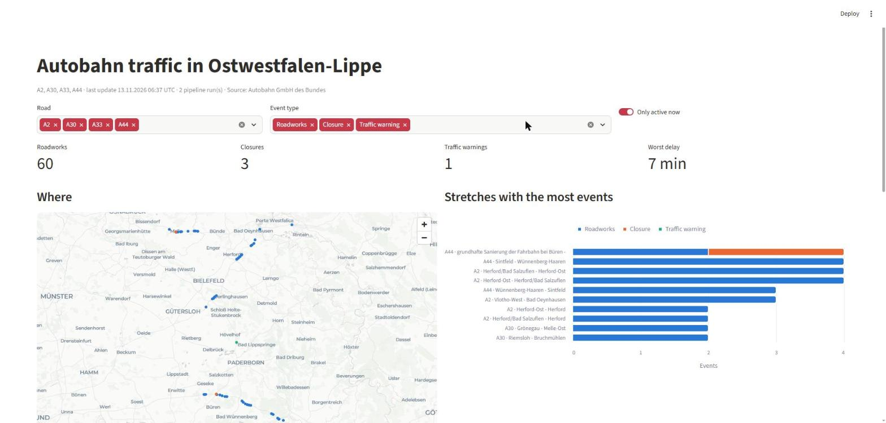

# Autobahn Traffic Pipeline (Ostwestfalen-Lippe)

A batch data pipeline that collects roadworks, traffic warnings and closures on the autobahns
around Ostwestfalen-Lippe (A2, A30, A33, A44), stores every snapshot, and models it with dbt.

Questions it answers: Which stretches have the most roadworks and closures? How long do
roadworks last? When do traffic jams happen and how long are the delays?

**Status:** work in progress. Extract, load, dbt modelling and the dashboard are done.



## How it works

```
Autobahn API ─► extract.py ─► data/raw/*.json ─► load.py ─► DuckDB raw_events
                                                              │
                                                     dbt (transform/)
                                                              │
                         stg_events (view) ─► fct_events (table) ─► agg_stretch_summary (table)
                                                              │
                                                  Streamlit dashboard (dashboard/app.py)
```

| Step | What it does | Tools |
|---|---|---|
| Extract | Calls the API for 4 roads × 3 event types and saves each response unchanged | Python, requests |
| Load | Reads all raw files into DuckDB, one row per event per run; files already loaded are skipped (idempotent) | DuckDB, SQL |
| Staging | Cleans types and text, splits the title into stretch and direction, flags events inside OWL | dbt, SQL |
| Fact | One row per event in OWL: first/last seen, snapshot count, worst delay, still active or not | dbt, SQL |
| Summary | Roadworks, closures and warnings per road stretch and direction | dbt, SQL |
| Dashboard | KPIs, map, top stretches, events per run, filterable table | Streamlit, Altair |
| Tests | 4 pytest unit tests (Python) and 12 dbt data tests (not null, unique, accepted values, custom SQL checks) | pytest, dbt |

Each run is a snapshot. Running the pipeline repeatedly shows when an event first appeared
and when it disappeared, which gives its duration.

## Run it

```bash
python -m venv .venv
.venv/Scripts/activate        # Windows; on Linux/macOS: source .venv/bin/activate
pip install -r requirements.txt

python -m pipeline.run        # extract -> load -> dbt build (models + tests)
python -m pytest              # Python unit tests
streamlit run dashboard/app.py   # open the dashboard at http://localhost:8501
```

No API key or registration needed. The steps can also run one at a time:
`python -m pipeline.extract`, `python -m pipeline.load`, and `dbt build --profiles-dir .` inside `transform/`.

## Design notes

- **Raw data is kept unchanged**, so the models can be rebuilt from scratch at any time.
- **Idempotent load:** a `loaded_files` table records every file loaded, so reruns add no duplicates.
- **OWL filter is approximate:** two latitude/longitude boxes, defined in `stg_events.sql`.
  Places just over the border (e.g. Melle) can still be included.
- **Durations depend on run frequency:** `first_seen_at` / `last_seen_at` are only as precise as the schedule.

## Roadmap

- [x] Extract raw JSON from the API
- [x] Idempotent load into DuckDB
- [x] dbt models: staging, OWL filter, one row per event, stretch summary, data tests
- [ ] Scheduled runs with GitHub Actions
- [x] Streamlit dashboard: KPIs, map, top stretches, events per run

## Data source

[Autobahn GmbH des Bundes](https://verkehr.autobahn.de/o/autobahn) public traffic API.
